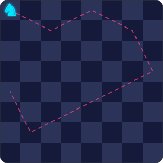

<!-- ▼ SECTION: header -->

<!-- Rotating lines: edit the text after  lines=  (separate lines with ;  and spaces with +) 
modify on:

https://readme-typing-svg.demolab.com/demo/?weight=600&size=22&pause=1200&color=00E5FF&center=true&vCenter=true&width=760&height=40&lines=Hello!+%F0%9F%91%8B+I%27m+Erik;I+make+factories+talk+to+software+%F0%9F%8F%AD;Python+%2B+MQTT+%2B+a+little+bit+of+chaos;3rd+place+county+informatics+olympiad+%F0%9F%8F%86;I+play+chess+%E2%99%9F%EF%B8%8F+and+think+3+moves+ahead

-->

 

<!-- ▼ SECTION: socials (add a badge = copy a line, change name/colour/logo/link) -->

<!-- ▼ SECTION: terminal intro -->

  

<!-- ▼ SECTION: character sheet (RPG style – edit the table rows) -->
## 🎮 Player profile

| | |
|---|---|
| **Name** | Erik Szegedi |
| **Class** | Software Engineer — Industrial IoT & Automation |
| **Guild** | Babeș-Bolyai University, Cluj-Napoca 🎓 (B.Sc. Computer Science, graduating July 2027) |
| **Home base** | Romania 🇷🇴 |
| **Languages spoken** | Hungarian 🇭🇺 (native) · Romanian 🇷🇴 (fluent) · English 🇬🇧 (C1) |
| **Main weapons** | Python · C++ · Next.js · MQTT |
| **Side quests** | ♟️ chess · 🎮 gaming · 🐧 Linux tinkering |
| **Special power** | Turning messy real-world processes into clean data flows |

<!-- ▼ SECTION: achievements (add a row = a new achievement) -->
## 🏆 Achievements unlocked

| | Achievement | Details |
|---|---|---|
| 🥉 | **County Informatics Olympiad 2023** | 3rd place in Sălaj County, qualified for the *Grigore Moisil* interregional competition |
| 🏭 | **Digitalization Concept @ Tenaris Silcotub** | Designed a warehouse workflow concept (picking efficiency + automated bin management); praised by the evaluation committee, rated **4.02 / 5** |
| 🤝 | **Cross-functional team with Accenture** | Helped build a virtual factory for validating production logic |
| 🛡️ | **RBAC boss defeated** | Built a role-based access control system for 100+ active users |

<!-- ▼ SECTION: missions = projects (no repo needed – cards describe the work) -->
## 🚀 Missions

<table>
  <tr>
    <td width="33%" valign="top">
      <h3>🏭 Virtual Factory</h3>
      Unreal Engine · MQTT · Python
      
High-fidelity virtual factory for testing and validating production logic. MQTT in Unreal Engine streams external data for real-time visualisation, and a Python engine uses normal-distribution sampling to generate realistic stress-test data.

      🔒 <i>Team project with Accenture — source is private.</i>
    </td>
    <td width="33%" valign="top">
      <h3>📋 Personnel Dashboard</h3>
      Next.js · Node.js · MySQL
      
Admin platform for a virtual community: personnel management and automated report generation for 100+ users. SSR frontend, MySQL schema with role-based access control.

    </td>
    <td width="33%" valign="top">
      <h3>📦 Smart Warehouse Concept</h3>
      Process design · Documentation
      
Digitalization concept at Tenaris Silcotub: faster picking, automated bin management, and feasibility studies for replacing manual stock checks with accurate inventory data.

    </td>
  </tr>
  <!-- ADD MORE: copy a <td>…</td> block, or a whole <tr>…</tr> row -->
</table>

<!-- ▼ SECTION: tech stack (edit the lists after  i=  → full icon list: https://skillicons.dev) -->
## 🧰 Skill tree

  <b>Languages</b> 
    
  <b>Frameworks</b> 
    
  <b>Tools & platforms</b> 
  
    
  Also: x86 Assembly · Distributed Systems · Computer Networks · Probability & Statistics · Numerical Methods

<!-- ▼ SECTION: chess -->
## ♟️ Chess + code

<table>
  <tr>
    <td width="340" align="center">
      
    </td>
    <td valign="middle">
      
I play chess in my free time, and it shapes how I code: <b>plan a few moves ahead, protect the king (production), and don't sacrifice the queen for a pawn (a quick hack).</b>

      
The knight is my favourite piece: it takes the unexpected route and still gets there.

      <a href="https://www.chess.com/member/erikszegedi">♟️ Challenge me on chess.com</a>
    </td>
  </tr>
</table>

<!-- ▼ SECTION: stats -->
## 📊 GitHub stats

  
  
   
  

<!-- ▼ SECTION: contribution snake (needs .github/workflows/snake.yml — run it once from the Actions tab) -->

  <picture>
    <source media="(prefers-color-scheme: dark)" srcset="https://raw.githubusercontent.com/szupererik2/szupererik2/output/github-snake-dark.svg"/>
    <source media="(prefers-color-scheme: light)" srcset="https://raw.githubusercontent.com/szupererik2/szupererik2/output/github-snake.svg"/>
    
  </picture>

<!-- ▼ SECTION: contact CTA -->

### 📡 Looking for a Software Engineer who speaks both *IT* and *factory floor*?
**[Let's connect on LinkedIn](https://www.linkedin.com/in/erik-szegedi-1b9747357/)** · **[Send me an email](mailto:szegedierik04@gmail.com)**

Fun fact: I play chess, so I already know how to checkmate a deadline. ♟️

<!-- ▼ SECTION: footer wave -->

